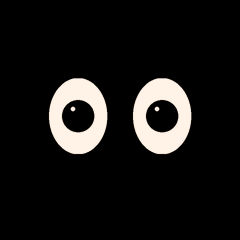
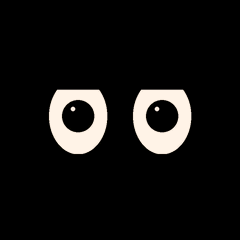
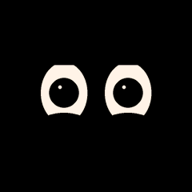
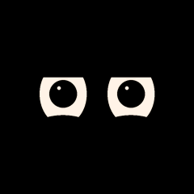
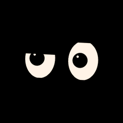
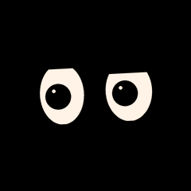
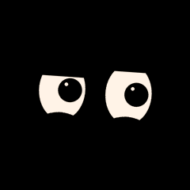
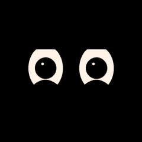

# Puppy Alive V1

**Ferdig lokal PC-pakke, uten firmwareendringer.**

- [Last ned viewer-ZIP (20 MB)](puppy-alive-v1-viewer.zip?raw=true)
- [Last ned komplett pakke med redigerbare kilder og PNG/EAF/GIF (54 MB)](puppy-alive-v1-complete.zip?raw=true)
- [Bruksanvisning](docs/README.md) · [Tester og størrelser](docs/results.md) · [Luwu/EAF-kompatibilitet](docs/luwu-compatibility.md)

Pakk ut hele ZIP-filen og åpne **START-HER.html**. Behold filer og mapper sammen.
Ingen installasjon, server eller internett kreves. `gallery.html` fungerer uten JavaScript.
Den tidligere vieweren finnes under `legacy/START-HER.html`.

29 følelser × tre intensiteter, 20 kodeprimitiver, 10 overgangsprofiler og en lokal
Emotion Playground. Original og V2 er bevart for sammenligning. Nytt navn vises
aldri som en eksisterende original. **proud er en tidligere lokal utvidelse.**

117 EAF/GIF-klipp og 9627 rammer er kontrollert. Den uendrede installerte
Espressif C-dekoderen gjenskapte alle rammer nøyaktig på host. Automatisk test
av den faktiske utpakkede ZIP-en bekrefter lokal offline-visning, 174 valg,
30 demo-/overgangsklipp, 71 native GIF-er og ingen JS-feil i Chromium.

Standard assets er 6345811 byte i en 8388608-byte partisjon. Extended-medium
med alle 29 er 7870975 byte. Alle intensitetene samlet er for store for firmware;
de finnes i PC-pakken. Ingen maskinvareytelse eller fysisk kompatibilitet er
bekreftet. LLM, lyd, motorer, OTA og firmware er ikke endret. Playground er en
hostsimulator, uten forbindelse til den offisielle AI-tjenesten.

Kilder kontrollert: rig_omni c2b42cd, rig_puppy 5b5adc5 og RIG-Muse 8ffe105.
Se dokumentasjonen for fullstendige commits, fakta, forslag og gjenværende robottester.

## Se medium-animasjonene direkte

Disse GIF-ene er også inkludert i ZIP-en. Klikk en animasjon for original 240×240-fil.

| Følelse | Forhåndsvisning |
|---|---|
| neutral |  |
| happy |  |
| sad |  |
| angry |  |
| surprised |  |
| thinking |  |
| winking |  |
| cool |  |
| laughing |  |
| loving |  |
| crying |  |
| confused |  |
| embarrassed |  |
| sleepy |  |
| confident |  |
| delicious |  |
| kiss |  |
| relaxed |  |
| shocked |  |
| silly |  |
| proud |  |
| curious |  |
| skeptical |  |
| attentive |  |
| uncertain |  |
| excited |  |
| worried |  |
| mischievous |  |
| grateful |  |
