# Puppy – se uttrykkene direkte

Disse animasjonene er vanlige GIF-bilder. De vises direkte på GitHub uten å kjøre viewer-kode eller laste ned en ZIP. Alle GIF-ene er laget fra de ferdige EAF-filene, med piksel- og tidskontroll mot EAF-dekoderen.

For avspillingskontroller: last ned [den portable vieweren](../puppy-viewer-ready.zip?raw=true), pakk ut hele ZIP-filen og åpne **START-HER.html**. Behold de øvrige filene og previews-mappen ved siden av. Åpne **Avansert EAF-spiller** for pakkevalg, sammenligning, pause og rammesteg.

| Følelse | Original | puppy-eyes-v2 |
|---|---|---|
| **neutral** | 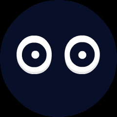 |  |
| **happy** |  |  |
| **sad** | 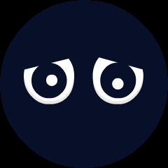 |  |
| **angry** | 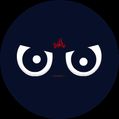 | 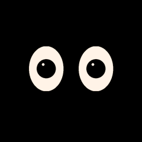 |
| **surprised** | 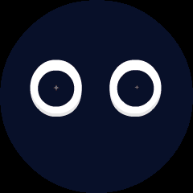 |  |
| **thinking** |  |  |
| **winking** |  |  |
| **cool** | 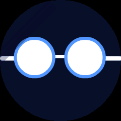 |  |
| **laughing** | 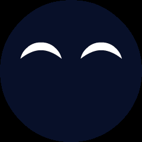 |  |
| **loving** | 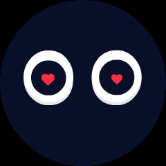 |  |
| **crying** | 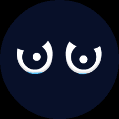 |  |
| **confused** | 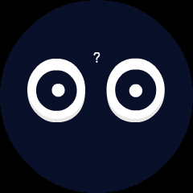 |  |
| **embarrassed** | 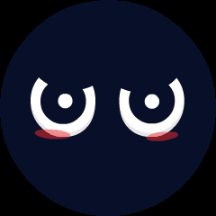 |  |
| **sleepy** | 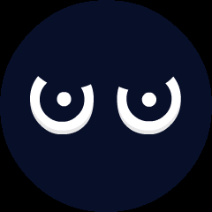 | 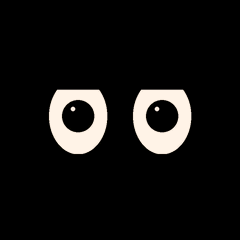 |
| **confident** | 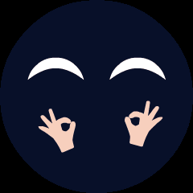 |  |
| **delicious** | 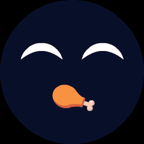 |  |
| **kiss** | 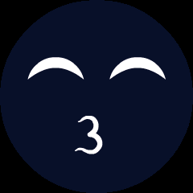 | 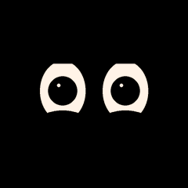 |
| **relaxed** | 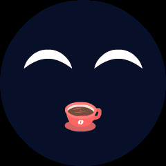 | 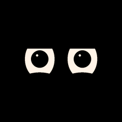 |
| **shocked** | 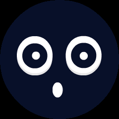 |  |
| **silly** | 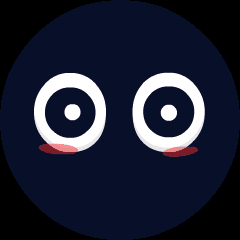 |  |
| **proud** | 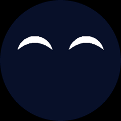 |  |

Systemuttrykk – uendret fra originalpakken

| Uttrykk | Animasjon |
|---|---|
| calibration | 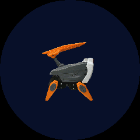 |
| icon_speaker_zzz |  |
| launch |  |
| listen | 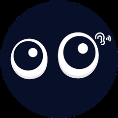 |
| nvs_reset | 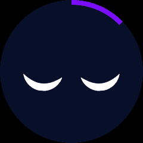 |
| remote_mode | 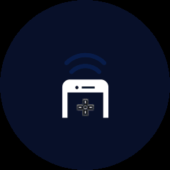 |
| scanning | 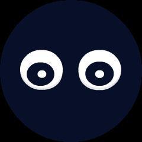 |
| wificonfig_domestic |  |
| wificonfig_overseas |  |

Originalpakken og firmwarekonfigurasjonen er uendret. puppy-eyes-v2 er fortsatt en separat kandidat, ikke aktivert på roboten. Det er ikke gjennomført en fysisk maskinvaretest.
